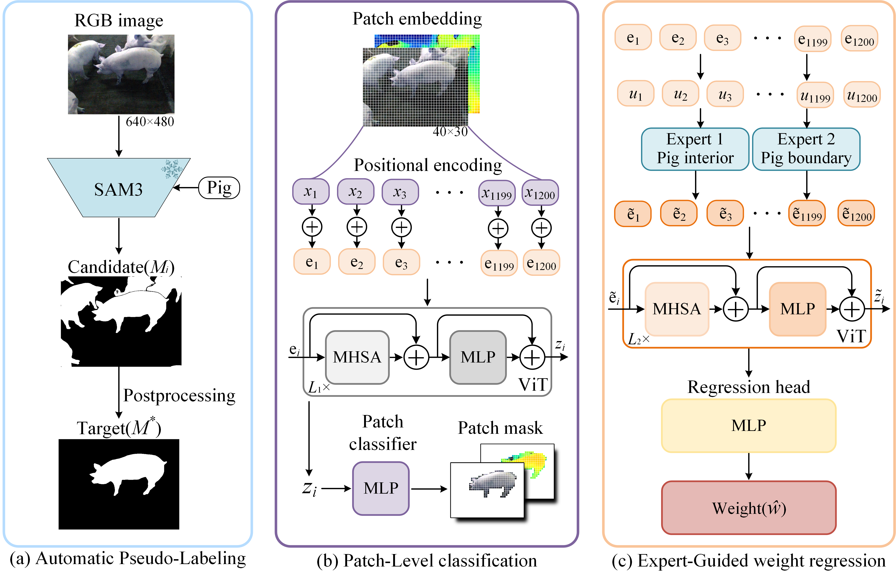

# PaCReNet

PaCReNet is a research method and project for pig weight estimation from handheld RGB-D images. It includes data loading and auditing, two-stage training, regional experts and ViT regression, and optional pig depth preprocessing. The project repository is [lipenghuai/PaCReNet](https://github.com/lipenghuai/PaCReNet).

## Method overview



1. **Stage 1: patch classification.** Predict background, body (the full pig body), and edge classes on the native `480×640` grid using `16×16` patches by default. Topological connectivity loss and connected-component postprocessing are optional.
2. **Stage 2: weight regression.** Freeze the stage 1 contributor network and zero background patches by default. Route body and edge patches through separate regional experts, then predict weight in kilograms with a shared ViT.

Supported input modalities are `rgb`, `depth`, and `rgbd`; model profiles are `tiny`, `small`, `base`, and `large`. The default profile is `small`.

## DATA

```
通过网盘分享的文件：data_zhj-pre.zip
链接: https://pan.baidu.com/s/1VJ7DehqH8DJmSmqXypWMnQ?pwd=qwer 提取码: qwer
```

